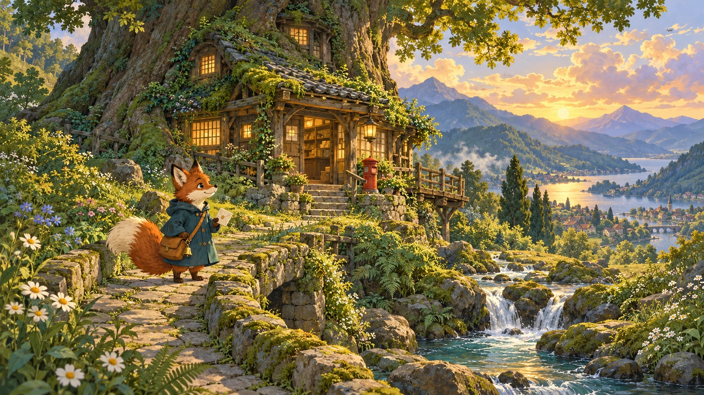
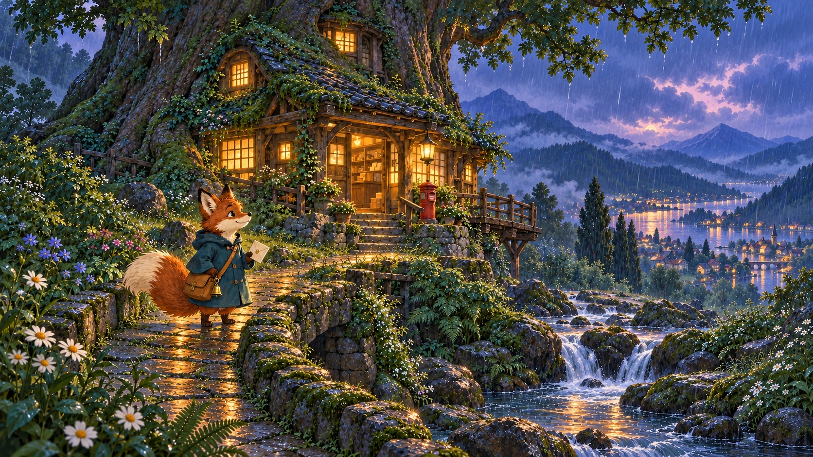
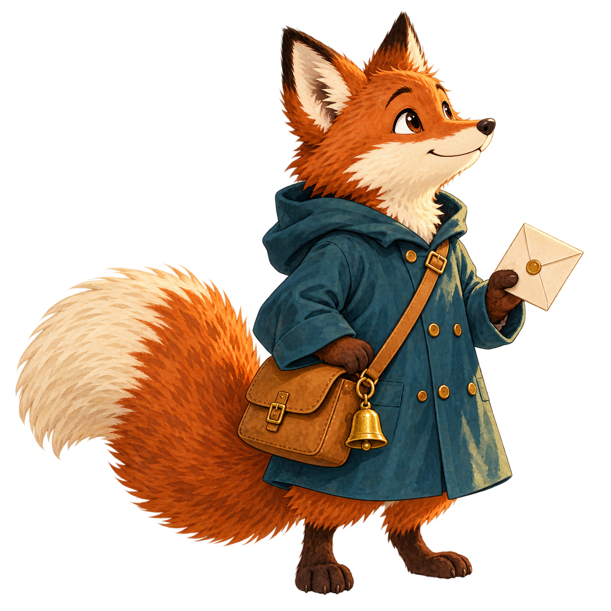

# A Codex image walkthrough

[README](../README.md) · [Getting started](getting-started.md) · [Tool reference](tool-reference.md)

The README follows one original fox postmaster through three actual Codex calls: a new scene, a reference-guided weather edit and a transparent character cut-out. The short prompts in the README are examples of what to ask an agent. This page records the longer prompts and settings used to make the displayed images.

All three calls used `imagegen` with the default Codex backend. `model` and `quality` were omitted; no override is claimed to have improved the result. The output paths below are repository-relative equivalents of the temporary paths used during generation. Only those paths have been adapted.

## 1. Create the woodland post office

[Full-size PNG](images/forest-post-office.png)



Arguments other than `prompt`:

```json
{
  "out": "docs/images/forest-post-office.png",
  "size": "1672x941",
  "background": "opaque"
}
```

<details>
<summary>Full prompt</summary>

Create one exceptionally beautiful original illustration for an image-generation plugin's example gallery: a wide, cinematic, hand-painted Japanese fantasy-animation landscape with a Studio Ghibli-inspired atmosphere. An old woodland post office is built into the base of a gigantic camphor tree on a green hillside, with a moss-covered tiled roof, weathered timber walls, a tiny red postbox, warm paper windows, a narrow stone footbridge over a clear stream, ferns, white daisies and wildflowers, and distant blue mountains beneath luminous late-afternoon clouds. In the near foreground beside the bridge stands one original small anthropomorphic rust-red fox postmaster, about one fifth of the image height, with a cream muzzle, large pointed ears, a very bushy cream-tipped tail, a dark teal raincoat, a small ochre cross-body mail satchel, a tiny brass bell on the satchel and a cream envelope in one paw. Make the fox's readable silhouette and distinctive teal coat memorable, to be reused in later images. Give the scene carefully composed foreground, middle distance and background, delicate gouache and watercolor brushwork, rich botanical detail, warm honey light, cool forest greens, a quiet sense of everyday wonder, and exquisite animation-background craftsmanship. Keep the whole house, bridge and fox comfortably in frame. No written words, letters, typography, logo, signature, watermark, collage, border or user interface. No existing film characters. Make this a finished full-bleed narrative illustration, not a mockup.

</details>

The tool reported **1672x941 pixels**. The scene gives later calls a concrete character, outfit, setting and composition to follow.

## 2. Edit the scene with a reference

[Full-size PNG](images/forest-post-office-rain.png)



Arguments other than `prompt`:

```json
{
  "out": "docs/images/forest-post-office-rain.png",
  "size": "1672x941",
  "images": ["docs/images/forest-post-office.png"],
  "background": "opaque"
}
```

<details>
<summary>Full prompt</summary>

Image 1 is the approved original illustration: it defines the post office, giant tree, stone footbridge, fox postmaster, landscape composition and hand-painted Japanese fantasy-animation style. Recreate the same scene faithfully with the same camera position, building silhouette, bridge, distant lake and mountains, and the same rust-red fox with cream muzzle and tail tip, dark teal raincoat, ochre mail satchel, tiny brass bell and cream envelope. Apply one coherent edit: change the weather and time to a gentle rainy blue hour. Give the sky luminous indigo and lavender rainclouds, let fine rain cross the scene, add believable wet glints to the stone bridge and leaves, and make the existing paper windows and a few hanging lanterns glow warm amber against the cool forest. Add a small warm reflection in the stream. The fox remains clearly visible, cheerful and recognizable, with its envelope and outfit intact; it may now look up at the rain. Preserve the warm, tender, Studio Ghibli-inspired hand-painted animation-background craftsmanship, delicate gouache and watercolor textures, quiet everyday magic and detailed foliage. Keep all image elements in the same overall locations; do not redesign the post office or replace the character. No written words, typography, logo, signature, watermark, collage, border or interface. Deliver one finished full-bleed landscape illustration.

</details>

The tool again reported **1672x941 pixels**. The fox, building, bridge and landscape remain recognisable, while the sky, rain, reflections and lighting change. This is a regenerated variation, not a pixel-preserving local edit.

## 3. Make a transparent illustrated icon

[Full-size transparent PNG](images/fox-postmaster-icon.png)



Arguments other than `prompt`:

```json
{
  "out": "docs/images/fox-postmaster-icon.png",
  "size": "1254x1254",
  "images": ["docs/images/forest-post-office-rain.png"],
  "background": "transparent"
}
```

<details>
<summary>Full prompt</summary>

Image 1 is the approved original rainy woodland-post-office illustration. Use ONLY its fox postmaster as the character reference: match the rust-red fur, cream muzzle and cheeks, large pointed ears with dark tips, generous fluffy cream-tipped tail, dark teal raincoat with small brass buttons, ochre leather cross-body mail satchel, tiny hanging brass bell, and cream envelope. Create one beautifully drawn standalone full-body illustrated mascot icon of this exact original fox, in a friendly three-quarter pose looking slightly upward, holding the envelope in one paw. It should feel like a carefully painted character cel from a Studio Ghibli-inspired Japanese fantasy animation: elegant confident silhouette, tender expressive face, richly controlled watercolor and gouache shading, a few beautiful fur strokes, readable shapes at small sizes, lovely warm russet against deep teal. Keep the character's design faithful to Image 1 while simplifying fine detail slightly for an avatar or illustrated icon. Include the complete ears, feet, tail, satchel, bell and envelope, with generous clear margin on every side of a square canvas. One character only, large and centered, no environment, no trees, no bridge, no rain, no scenery, no ground plane, no drop shadow, no circular badge, no app tile, no enclosing shape, no border, no written text, no logo, no signature or watermark. The deliverable is a clean reusable cut-out character illustration, not a screenshot or a mockup.

</details>

The output is **1254x1254 pixels**. The background argument requests a cut-out, while the reference supplies the character design. This is a raster illustration suitable for an avatar, sticker or illustrated icon; it isn't an editable vector icon.

## Transparency check

The original PNG was decoded in a browser canvas and every pixel's alpha was inspected:

| Alpha | Pixels |
| --- | --- |
| 0, fully transparent | 875,997 |
| 1-254, partially transparent | 696,107 |
| 255, fully opaque | 412 |

The image was also viewed on warm-white and dark backgrounds. It has a real transparent background, not a painted checkerboard, and soft alpha across much of the subject. No matting, alpha correction or background removal was applied after generation.

The two landscape previews are WebP copies encoded at quality 90 for display. Their linked PNG originals and the transparent icon are the bytes returned by the tool, without resizing, cropping, recolouring or compositing. The generated PNGs are included so you can inspect or reuse the full-size results.

## Try your own variation

Use one of the generated images as a reference and name a specific change: another season, a different palette or a new expression. Keep your prompt clear about the role of each reference and inspect what changed. [The tool reference](tool-reference.md) covers reference limits, supported sizes and transparency behavior.
